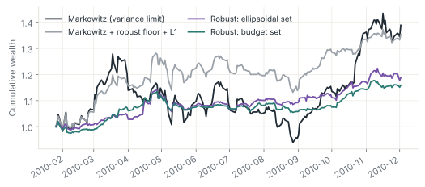

<div align="center">

# PortfolioOpt.jl

<p><sub><b>UNCERTAINTY SETS · AMBIGUITY SETS · RISK MEASURES</b></sub></p>

[](https://github.com/andrewrosemberg/PortfolioOpt.jl/actions/workflows/CI.yml?query=branch%3Amaster) [](https://codecov.io/gh/andrewrosemberg/PortfolioOpt.jl) [](https://andrewrosemberg.github.io/PortfolioOpt.jl/stable) [](https://andrewrosemberg.github.io/PortfolioOpt.jl/dev) [](https://github.com/invenia/BlueStyle) [](https://github.com/JuliaTesting/Aqua.jl)

</div>

<p align="center">
  <picture>
    <source media="(max-width: 640px)" srcset="docs/src/assets/diagrams/portfolioopt--formulation-compact.svg">
    
  </picture>
</p>
<p align="center"><i>A returns model, a measure and its role are independent choices; together they make one portfolio problem, which JuMP solves as a conic program.</i></p>

PortfolioOpt.jl writes portfolio optimization problems as [JuMP](https://jump.dev) models. How the returns are
modeled (a distribution, an uncertainty set or an ambiguity set), which risk measure is applied, and whether that
measure enters the objective or a constraint are separate objects, so swapping a set or a measure leaves the rest of
the formulation untouched. Each supported combination is added to the model as a conic reformulation that any conic
solver supported by JuMP can solve, and a walk-forward backtest evaluates the resulting strategies.

## Installation

```julia
using Pkg
Pkg.add("PortfolioOpt")
Pkg.add("Clarabel") # a conic solver: linear, SOC, exponential and PSD cones
```

## Example

```julia
using PortfolioOpt, Clarabel, Distributions, LinearAlgebra

returns = Matrix(rand(MvNormal([0.001, 0.0008, 0.0012], Diagonal([0.02, 0.015, 0.025] .^ 2)), 250)') # T × N

d = forecast(EmpiricalGaussian(120), returns) # Gaussian forecast from the last 120 periods
s = forecast(EmpiricalSamples(120), returns)  # empirical distribution of the same periods
optimizer = optimizer_with_attributes(Clarabel.Optimizer, "verbose" => false)

# Markowitz: maximize the expected return with the standard deviation at most 1.2%
markowitz = PortfolioFormulation(MAX_SENSE,
    ObjectiveTerm(ExpectedReturn(d)),
    RiskConstraint(SqrtVariance(d), LessThan(0.012)),
)
# CVaR: the mean of the 5% worst outcomes at least -2%
cvar = PortfolioFormulation(MAX_SENSE,
    ObjectiveTerm(ExpectedReturn(s)),
    RiskConstraint(ConditionalExpectedReturn(s; α=0.05), GreaterThan(-0.02)),
)
# distributionally robust: worst case CVaR over a moment ambiguity set
dro = PortfolioFormulation(MAX_SENSE,
    ObjectiveTerm(ConditionalExpectedReturn(MomentUncertainty(d; γ1=0.05, γ2=1.5); α=0.1)),
)

w = portfolio_weights(markowitz, 3, optimizer) # long only, budget 1; the rest stays in the risk free asset
```

Extra JuMP constraints can be added before solving:

```julia
market = VolumeMarket(3; budget=1.0, allow_short_selling=false)
model, w, _ = build_portfolio_model(market, markowitz, optimizer)
@constraint(model, w .<= 0.4)
change_bids!(market, model, w) # solves and stores the decision
bids(market)
```

<p align="center">
  
</p>

**Four documented strategies on the package's six-stock test dataset, 2010, without transaction costs.** The
mean–variance portfolio of Markowitz (1952) with a variance limit; the same strategy with a worst-case return floor
over the box set and an ℓ1 penalty; and expected-return maximization with a worst-case return floor over an
ellipsoidal or a budget set. Each strategy differs from the others in one or two arguments of the formulation. The
figure re-runs the documentation examples to illustrate the backtest and makes no claim about the strategies.

## Supported measures and sets

| Measure | Over | Value | Cones | Reference |
|:--|:--|:--|:--|:--|
| `ExpectedReturn` | any distribution | `r̂'w` | — | |
| `Variance`, `SqrtVariance` | any distribution | `w'Σw`, `‖Σ^½ w‖` | quadratic / (rotated) SOC | Markowitz (1952) |
| `WorstCaseReturn` | `DeterministicSamples` | `min_s r_s'w` | LP | Fernandes et al. (2016) |
| `ConditionalExpectedReturn` | `DeterministicSamples` | −CVaR_α | LP | Rockafellar & Uryasev (2000) |
| `ExpectedUtility(·, ExponentialUtility(a))` | `MvNormal`, Gaussian mixture, samples | `E[(1 − e^{−aR})/a]` | exponential | Luxenberg & Boyd (2024) |
| `CertaintyEquivalent(·, ExponentialUtility(a))` | `MvNormal`, Gaussian mixture, samples | `−log E[e^{−aR}]/a` | exponential | |
| `ConeRegularizer` | — | `‖Mw‖_K` | the norm cone | |
| `ExpectedReturn` | `BudgetSet` | worst case mean | LP (dual) | Bertsimas & Sim (2004) |
| `ExpectedReturn` | `EllipticalSet` | `r̂'w − δ‖Σ^½ w‖` | SOC | Ben-Tal & Nemirovski (2000) |
| `ExpectedReturn`, `ConditionalExpectedReturn`, `ExpectedUtility(·, PieceWiseUtility)` | `MomentUncertainty` | worst case over the moment set | PSD | Delage & Ye (2010); box support: Yang et al. (2014) |
| `ExpectedReturn` | `DuWassersteinBall` | worst case over a Wasserstein ball | norm cones | Du et al. (2021) |

Each row is stated as an optimization problem, with its conic reformulation and the conditions under which it is
exact, in the [Theory](https://andrewrosemberg.github.io/PortfolioOpt.jl/dev/theory/problem/) pages.

## What you need to provide

Returns, as a `T × N` matrix (one row per period) or a `TimeArray`, or directly a distribution of the next period
returns (any multivariate `Distributions.Sampleable`, or `DeterministicSamples` with one sample per column); and a JuMP
optimizer that supports the cones of the measures you use (Clarabel, SCS and Mosek support all of them). A backtest
also needs a `VolumeMarketHistory` of returns and a strategy function `(market, past_returns, ext) -> ...`.

## Extending

New measures, ambiguity sets, forecasters and markets are added by dispatch, without changing the package:

| To add | Subtype | Implement |
|:--|:--|:--|
| a risk measure or objective term | `PortfolioRiskMeasure` / `AbstractPortfolioTerm` | `calculate_measure!(m, w)` |
| an ambiguity set | `CenteredAmbiguitySet` | `distribution(s)` and `calculate_measure!` for the measures over it |
| a forecaster | `AbstractForecaster` | `forecast(f, returns::AbstractMatrix)` |
| a market | `PortfolioMarket` | `num_assets`, `market_budget`, `set_market_budget`, `bids`, `set_bids!`, `clear_market!`, `total_profit` (optionally `market_model`) |

```julia
struct BoxSet{T,D} <: CenteredAmbiguitySet{T,D}
    d::D
    δ::T
end
PortfolioOpt.distribution(s::BoxSet) = s.d
function PortfolioOpt.calculate_measure!(m::ExpectedReturn{<:BoxSet}, w) # min over |μ - r̂| ≤ δ of μ'w
    model = JuMP.owner_model(first(w))
    t = @variable(model)
    @constraint(model, [t; w] in MOI.NormOneCone(length(w) + 1))
    return mean(ambiguityset(m))' * w - ambiguityset(m).δ * t
end
```

See [Extending PortfolioOpt](https://andrewrosemberg.github.io/PortfolioOpt.jl/dev/guide/extending/).

## Package extensions

The core depends only on JuMP, MathOptInterface, Distributions, PDMats, ProgressMeter, Reexport and standard
libraries. Loading these packages enables:

| Package | Adds |
|:--|:--|
| [TimeSeries.jl](https://github.com/JuliaStats/TimeSeries.jl) | a `TimeArray` of returns as a `VolumeMarketHistory` |
| [MarketData.jl](https://github.com/JuliaQuant/MarketData.jl) | `TestUtils.get_test_data()` (6 assets of daily prices) |
| [OptimalBids.jl](https://github.com/andrewrosemberg/OptimalBids.jl) | its `change_bids!`, `clear_market!` and `calculate_profit` accept any `PortfolioMarket` |

Upgrading from v1? See [Breaking changes in v2.0](https://andrewrosemberg.github.io/PortfolioOpt.jl/dev/guide/migration/).

## Related packages

PortfolioOpt.jl is part of a family of Julia packages for optimization under uncertainty and learning to optimize:

| Package | Scope |
|:--|:--|
| [OptimalBids.jl](https://github.com/andrewrosemberg/OptimalBids.jl) | bidding strategies in generic markets |
| [DecisionRules.jl](https://github.com/LearningToOptimize/DecisionRules.jl) | parametric decision rules for multistage stochastic programs |
| [LearningToOptimize.jl](https://github.com/LearningToOptimize/LearningToOptimize.jl) | proxy models that learn to solve optimization problems |

## Citation

If you use PortfolioOpt.jl in your work, please cite it (see [CITATION.cff](CITATION.cff)):

```bibtex
@software{rosemberg_portfolioopt_jl,
  author = {Rosemberg, Andrew},
  title  = {{PortfolioOpt.jl}: portfolio optimization formulations with JuMP},
  url    = {https://github.com/andrewrosemberg/PortfolioOpt.jl},
  version = {2.0.0},
  year   = {2026}
}
```

and the papers of the methods you use (listed in the Theory pages).

## Contributing

See [CONTRIBUTING.md](CONTRIBUTING.md). Licensed under the MIT license.
