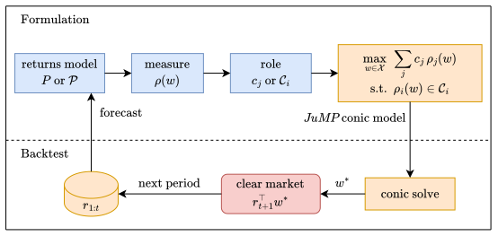

```@meta
CurrentModule = PortfolioOpt
```

# PortfolioOpt.jl

```@raw html
<p class="eyebrow">Uncertainty sets · Ambiguity sets · Risk measures</p>
<figure class="fig hero">
  <picture>
    <source media="(max-width: 640px)" srcset="assets/diagrams/portfolioopt--formulation-compact.svg">
    
  </picture>
  <figcaption><i>A returns model, a measure over it and the measure's role make one formulation. JuMP solves it as a conic program, and the backtest clears the decision against the realized returns before the next period.</i></figcaption>
</figure>
<p class="lede">A portfolio decision under uncertainty combines three choices that are easy to conflate: how the returns are modeled (a distribution, an uncertainty set or an ambiguity set), which risk measure is applied, and whether that measure enters the objective or a constraint. PortfolioOpt.jl keeps the three as separate objects and compiles each supported combination into a conic JuMP model, so swapping a set or a measure leaves the rest of the formulation untouched.</p>
```

A problem is a [`PortfolioFormulation`](@ref): objective terms and risk constraints built from
measures of the next period portfolio return, such as the expected return, the variance, the
conditional value at risk (Rockafellar & Uryasev, 2000), expected exponential utility and its
certainty equivalent, evaluated either over a distribution or in the worst case over an ambiguity
set: budget (Bertsimas & Sim, 2004) and ellipsoidal (Ben-Tal & Nemirovski, 2000) uncertainty sets,
moment uncertainty (Delage & Ye, 2010) with an optional box support (Yang et al., 2014), and
Wasserstein balls (Du et al., 2021). Each measure is added to the model as an exact conic
reformulation (linear, second order, exponential or semidefinite cones), so any conic solver
supported by JuMP can solve it. A small market interface and a walk-forward backtest are included
to evaluate the resulting strategies.

## Installation

```julia
using Pkg
Pkg.add("PortfolioOpt")
```

## Example

```@example index
using PortfolioOpt, Clarabel, Distributions, LinearAlgebra

d = MvNormal([0.010, 0.012, 0.008], Diagonal([0.02, 0.03, 0.01] .^ 2)) # forecast of the returns
formulation = PortfolioFormulation(MAX_SENSE,
    ObjectiveTerm(ExpectedReturn(d)),                # maximize the expected return
    RiskConstraint(SqrtVariance(d), LessThan(0.015)), # standard deviation at most 1.5%
)
w = portfolio_weights(formulation, 3, optimizer_with_attributes(Clarabel.Optimizer, "verbose" => false))
```

## Where to go next

* **Theory**: [the problem and the notation](theory/problem.md), the
  [risk measures](theory/measures.md) and [ambiguity sets](theory/ambiguity.md) as optimization
  problems, with the conditions under which each reformulation is exact.
* **Package guide**: [getting started](guide/getting_started.md), [concepts](guide/concepts.md),
  [extending the package](guide/extending.md) and the
  [breaking changes in v2.0](guide/migration.md).
* **Examples**: backtests of stochastic, robust and distributionally robust strategies, and how to
  assess a model.
* **[API reference](api.md)**.
